# RCC-APS System Diagrams

**Project:** Republic Central Colleges — Automated Payroll System (RCC-APS)

---

## Table of Contents

1. [Sitemap](#1-sitemap)
2. [Screen Flow Diagrams](#2-screen-flow-diagrams)
3. [Use Case Diagrams](#3-use-case-diagrams)
4. [Activity Diagrams](#4-activity-diagrams)
5. [Entity Relational Diagram (ERD)](#5-entity-relational-diagram-erd)
6. [Database Structure](#6-database-structure)

---

## 1. Sitemap

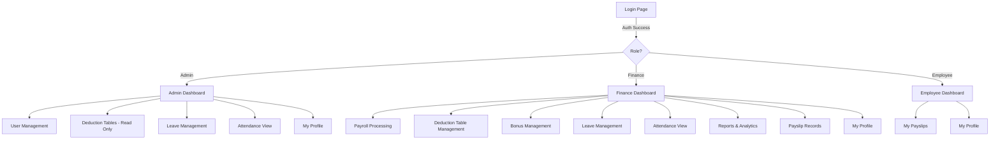

---

## 2. Screen Flow Diagrams

### M1: Authentication & Authorization

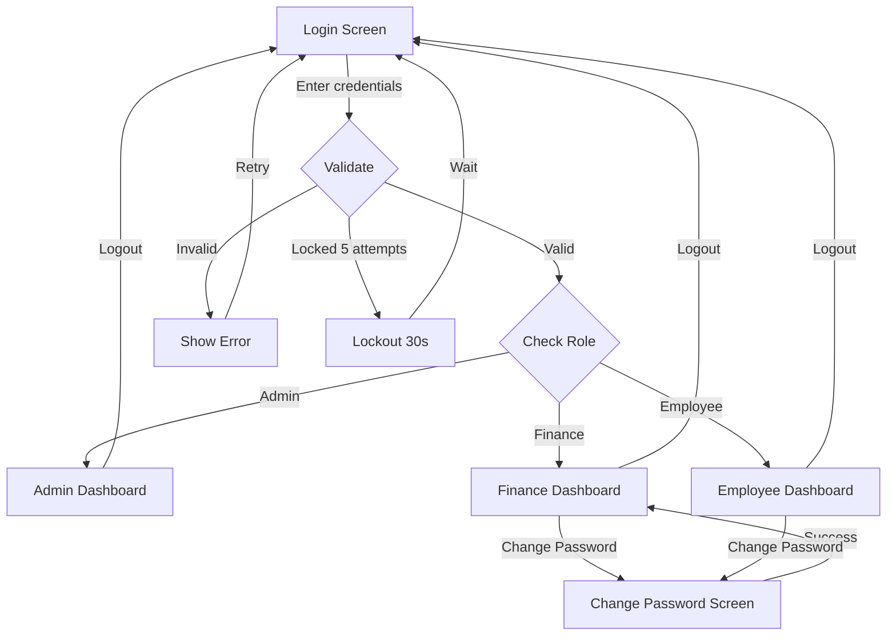

### M2: User & Employee Management

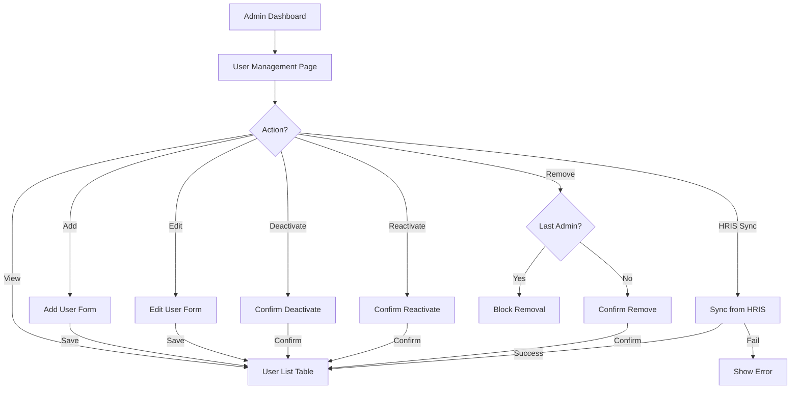

### M3: Payroll Computation Engine

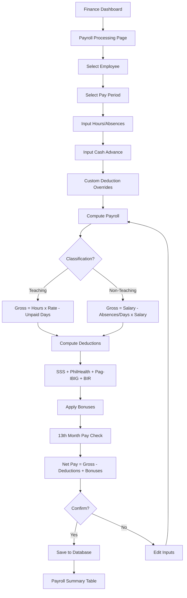

### M4: Statutory Deductions

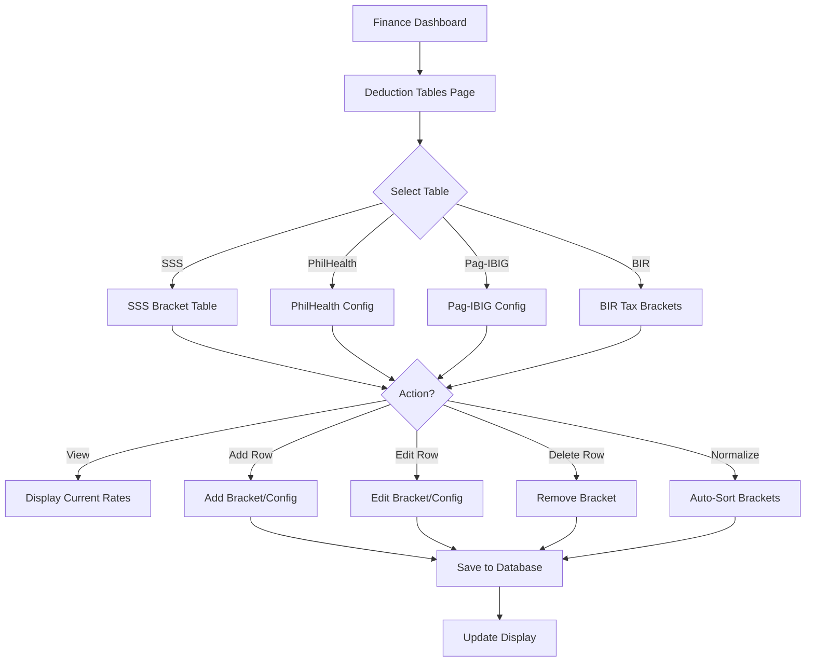

### M5: Bonus Management

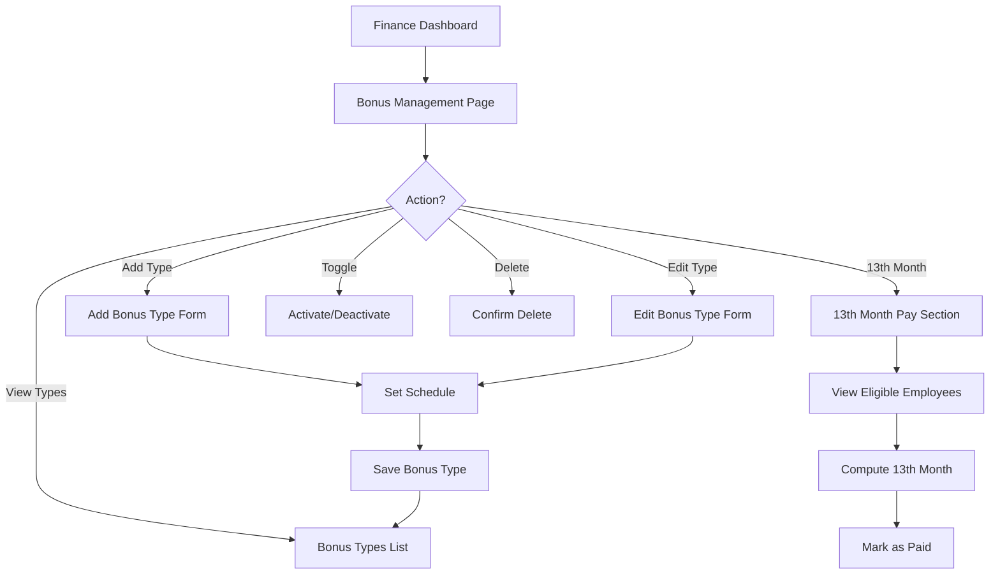

### M6: Leave Management

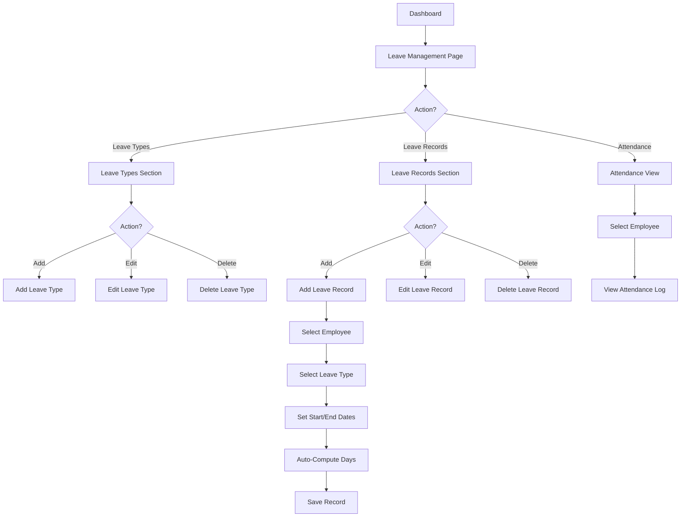

### M7: Reports & Analytics

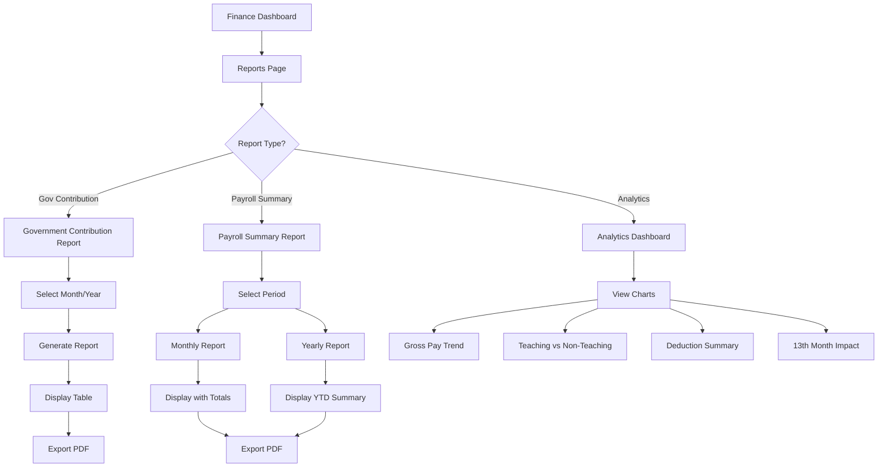

### M8: Payslip Generation

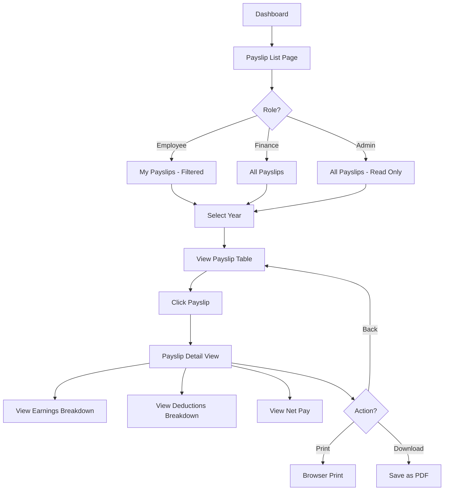

### M9: UI Framework & Shared Utilities

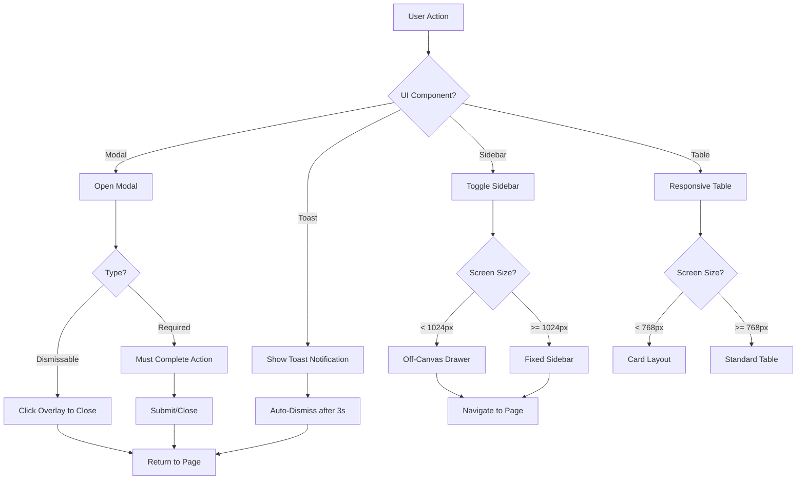

---

## 3. Use Case Diagrams

### M1: Authentication & Authorization

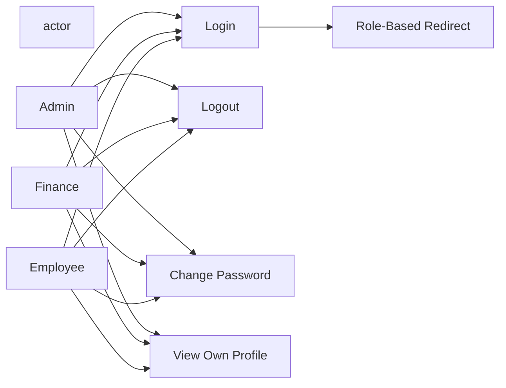

### M2: User & Employee Management

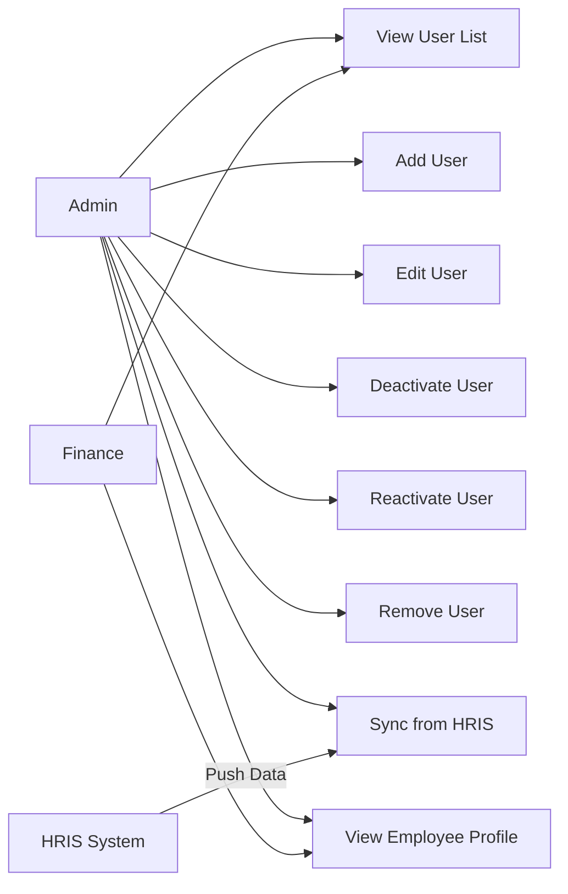

### M3: Payroll Computation Engine

```mermaid
flowchart LR
    actor Finance
    actor Employee

    UC1[Select Employee]
    UC2[Input Hours/Absences]
    UC3[Input Cash Advance]
    UC4[Set Custom Deductions]
    UC5[Compute Payroll]
    UC6[Confirm Payroll]
    UC7[View Payroll Summary]
    UC8[View Own Payroll]

    Finance --> UC1
    Finance --> UC2
    Finance --> UC3
    Finance --> UC4
    Finance --> UC5
    Finance --> UC6
    Finance --> UC7

    Employee --> UC8
```

### M4: Statutory Deductions

```mermaid
flowchart LR
    actor Finance
    actor Admin

    UC1[View SSS Table]
    UC2[Edit SSS Brackets]
    UC3[View PhilHealth Config]
    UC4[Edit PhilHealth Config]
    UC5[View Pag-IBIG Config]
    UC6[Edit Pag-IBIG Config]
    UC7[View BIR Brackets]
    UC8[Edit BIR Brackets]
    UC9[View All Tables - Read Only]

    Finance --> UC1
    Finance --> UC2
    Finance --> UC3
    Finance --> UC4
    Finance --> UC5
    Finance --> UC6
    Finance --> UC7
    Finance --> UC8

    Admin --> UC9
```

### M5: Bonus Management

```mermaid
flowchart LR
    actor Finance

    UC1[View Bonus Types]
    UC2[Add Bonus Type]
    UC3[Edit Bonus Type]
    UC4[Delete Bonus Type]
    UC5[Toggle Bonus Status]
    UC6[Set Bonus Schedule]
    UC7[Compute 13th Month Pay]
    UC8[Mark 13th Month as Paid]
    UC9[Set Tax Exemption Limit]

    Finance --> UC1
    Finance --> UC2
    Finance --> UC3
    Finance --> UC4
    Finance --> UC5
    Finance --> UC6
    Finance --> UC7
    Finance --> UC8
    Finance --> UC9
```

### M6: Leave Management

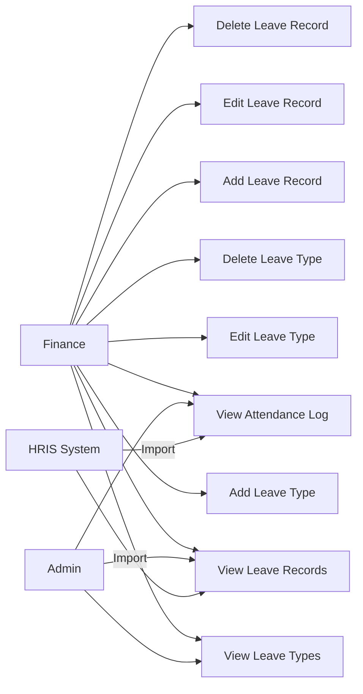

### M7: Reports & Analytics

```mermaid
flowchart LR
    actor Finance

    UC1[Generate Gov Contribution Report]
    UC2[Generate Payroll Summary - Monthly]
    UC3[Generate Payroll Summary - Yearly]
    UC4[View Analytics Dashboard]
    UC5[Export Report to PDF]

    Finance --> UC1
    Finance --> UC2
    Finance --> UC3
    Finance --> UC4
    Finance --> UC5
```

### M8: Payslip Generation

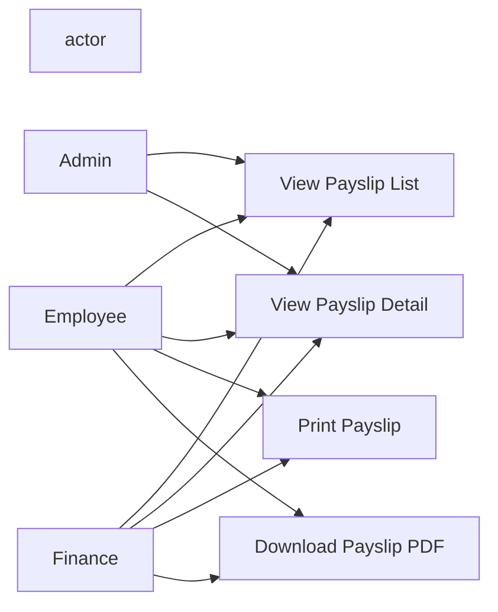

### M9: UI Framework & Shared Utilities

```mermaid
flowchart LR
    actor User

    UC1[Open Modal]
    UC2[Close Modal]
    UC3[Show Toast]
    UC4[Toggle Sidebar]
    UC5[Navigate Pages]
    UC6[View Responsive Table]
    UC7[Auto-Save Data]

    User --> UC1
    User --> UC2
    User --> UC3
    User --> UC4
    User --> UC5
    User --> UC6
    User --> UC7
```

---

## 4. Activity Diagrams

### M1: Authentication & Authorization

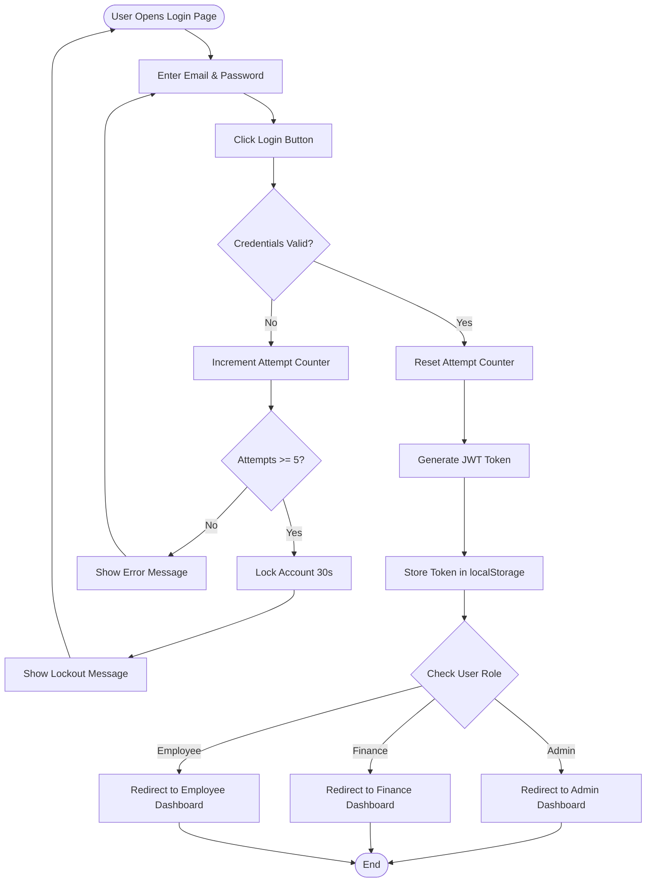

### M2: User & Employee Management

```mermaid
flowchart TD
    start([Admin Opens User Management]) --> A[Load User List from DB]
    A --> B[Display User Table]
    B --> C{User Action?}

    C -->|Add| D[Open Add User Form]
    D --> E[Fill User Details]
    E --> F{Email Exists?}
    F -->|Yes| G[Show Duplicate Error]
    G --> D
    F -->|No| H[Save User to DB]
    H --> B

    C -->|Edit| I[Open Edit User Form]
    I --> J[Modify User Details]
    J --> K[Save Changes to DB]
    K --> B

    C -->|Deactivate| L[Confirm Deactivation]
    L --> M[Set Status = Inactive]
    M --> B

    C -->|Reactivate| N[Confirm Reactivation]
    N --> O[Set Status = Active]
    O --> B

    C -->|Remove| P{Is Last Admin?}
    P -->|Yes| Q[Block Removal - Show Error]
    Q --> B
    P -->|No| R[Confirm Removal]
    R --> S[Delete User from DB]
    S --> B

    C -->|HRIS Sync| T[Fetch HRIS Data]
    T --> U[Map & Merge Employees]
    U --> V[Import Attendance & Leaves]
    V --> B

    B --> end1([End])
```

### M3: Payroll Computation Engine

```mermaid
flowchart TD
    start([Finance Opens Payroll]) --> A[Select Employee from Dropdown]
    A --> B[Select Pay Period]
    B --> C[Load Employee Data]

    C --> D{Classification?}
    D -->|Teaching| E[Input Hours Worked]
    D -->|Non-Teaching| F[Input Absence Days]

    E --> G[Calculate Gross Pay]
    F --> G

    G --> H[Input Cash Advance]
    H --> I[Set Custom Deduction Overrides]
    I --> J[Compute SSS Deduction]
    J --> K[Compute PhilHealth]
    K --> L[Compute Pag-IBIG]
    L --> M[Compute BIR Withholding Tax]
    M --> N[Sum All Deductions]

    N --> O[Check Applicable Bonuses]
    O --> P[Compute 13th Month Pay]
    P --> Q[Apply Tax Exemption]
    Q --> R[Calculate Net Pay]

    R --> S[Display Computation Result]
    S --> T{User Confirms?}

    T -->|No - Edit| U[Modify Inputs]
    U --> G

    T -->|Yes| V[Save Payroll Record]
    V --> W[Update Payroll Summary]
    W --> X[Mark Cash Advance Consumed]
    X --> end1([End])
```

### M4: Statutory Deductions

```mermaid
flowchart TD
    start([Finance Opens Deductions]) --> A[Load Current Tables]
    A --> B[Display Deduction Page]
    B --> C{Select Table}

    C -->|SSS| D[Show SSS Brackets]
    C -->|PhilHealth| E[Show PhilHealth Config]
    C -->|Pag-IBIG| F[Show Pag-IBIG Config]
    C -->|BIR| G[Show BIR Brackets]

    D --> H{Action?}
    E --> H
    F --> H
    G --> H

    H -->|Add Row| I[Open Add Bracket Form]
    I --> J[Enter Range & Values]
    J --> K[Validate Input]
    K --> L[Save to DB]
    L --> B

    H -->|Edit Row| M[Open Edit Bracket Form]
    M --> N[Modify Values]
    N --> O[Save to DB]
    O --> B

    H -->|Delete Row| P[Confirm Deletion]
    P --> Q[Remove from DB]
    Q --> B

    H -->|Normalize| R[Auto-Sort Brackets]
    R --> S[Validate No Overlaps]
    S --> B

    B --> end1([End])
```

### M5: Bonus Management

```mermaid
flowchart TD
    start([Finance Opens Bonus Mgmt]) --> A[Load Bonus Types]
    A --> B[Display Bonus Types List]
    B --> C{Action?}

    C -->|Add| D[Open Add Bonus Form]
    D --> E[Enter Name, Kind, Value]
    E --> F{De Minimis?}
    F -->|Yes| G[Flag as Tax-Exempt]
    F -->|No| H[Standard Bonus]
    G --> I[Set Schedule Dates]
    H --> I
    I --> J[Save Bonus Type]
    J --> B

    C -->|Edit| K[Open Edit Bonus Form]
    K --> L[Modify Details]
    L --> M[Save Changes]
    M --> B

    C -->|Toggle| N[Activate/Deactivate]
    N --> B

    C -->|Delete| O[Confirm Deletion]
    O --> P[Remove Bonus Type]
    P --> B

    C -->|13th Month| Q[Load Eligible Employees]
    Q --> R[Compute 13th Month per Employee]
    R --> S[Apply Tax Exemption]
    S --> T[Mark as Paid]
    T --> B

    B --> end1([End])
```

### M6: Leave Management

```mermaid
flowchart TD
    start([User Opens Leave Mgmt]) --> A[Load Leave Types & Records]
    A --> B[Display Leave Page]
    B --> C{Section?}

    C -->|Leave Types| D[Show Leave Types List]
    D --> E{Action?}
    E -->|Add| F[Enter Name & Paid Status]
    F --> G[Save Leave Type]
    G --> D
    E -->|Edit| H[Modify Leave Type]
    H --> D
    E -->|Delete| I[Confirm & Remove]
    I --> D

    C -->|Leave Records| J[Show Leave Records List]
    J --> K{Action?}
    K -->|Add| L[Select Employee]
    L --> M[Select Leave Type]
    M --> N[Set Start & End Dates]
    N --> O[Auto-Compute Days]
    O --> P[Save Leave Record]
    P --> J
    K -->|Edit| Q[Modify Record]
    Q --> J
    K -->|Delete| R[Confirm & Remove]
    R --> J

    C -->|Attendance| S[Select Employee]
    S --> T[Load Attendance from HRIS]
    T --> U[Display Attendance Log]
    U --> V[Show Clock-In/Out & Hours]

    B --> end1([End])
```

### M7: Reports & Analytics

```mermaid
flowchart TD
    start([Finance Opens Reports]) --> A[Load Report Page]
    A --> B{Report Type?}

    B -->|Gov Contribution| C[Select Month & Year]
    C --> D[Fetch Payroll Records]
    D --> E[Aggregate SSS/Phil/Pag/BIR per Employee]
    E --> F[Calculate Grand Totals]
    F --> G[Display Report Table]
    G --> H{Export?}
    H -->|Yes| I[Generate PDF]
    H -->|No| end1([End])

    B -->|Payroll Summary| J[Select Period]
    J --> K{Monthly or Yearly?}
    K -->|Monthly| L[Fetch Monthly Records]
    L --> M[Display with Totals]
    M --> H
    K -->|Yearly| N[Fetch Year Records]
    N --> O[Display YTD Summary]
    O --> H

    B -->|Analytics| P[Fetch All Data]
    P --> Q[Calculate Trends]
    Q --> R[Render Charts]
    R --> S[Bar: Gross Pay Trend]
    R --> T[Donut: Teaching vs Non-Teaching]
    R --> U[Summary: Deduction Averages]
    R --> V[Chart: 13th Month Impact]
    V --> end1

    I --> end1
```

### M8: Payslip Generation

```mermaid
flowchart TD
    start([User Opens Payslips]) --> A[Load Payslip List]
    A --> B[Filter by Year]
    B --> C[Display Payslip Table]
    C --> D[Click on Payslip]
    D --> E[Load Payroll Record Details]
    E --> F[Display Payslip Detail]

    F --> G[Show Employee Info]
    F --> H[Show Earnings Breakdown]
    F --> I[Show Deductions Breakdown]
    F --> J[Show Net Pay]

    H --> K[Base Salary]
    H --> L[Bonuses]
    H --> M[De Minimis]
    H --> N[13th Month Pay]

    I --> O[SSS]
    I --> P[PhilHealth]
    I --> Q[Pag-IBIG]
    I --> R[BIR Tax]
    I --> S[Cash Advance]
    I --> T[Custom Deductions]

    J --> U{User Action?}
    U -->|Print| V[Open Browser Print Dialog]
    V --> W[Auto-Generate Filename]
    W --> end1([End])
    U -->|Download| X[Save as PDF]
    X --> end1
    U -->|Back| C
```

### M9: UI Framework & Shared Utilities

```mermaid
flowchart TD
    start([User Interaction]) --> A{Component Type?}

    A -->|Modal| B[Trigger Modal Open]
    B --> C[Render Overlay + Content]
    C --> D{Modal Type?}
    D -->|Dismissable| E[Click Overlay]
    E --> F[Close Modal]
    D -->|Required| G[User Completes Action]
    G --> H[Submit Form]
    H --> F
    F --> end1([End])

    A -->|Toast| I[Trigger Toast]
    I --> J[Render Toast with Icon]
    J --> K[Auto-Dismiss Timer 3s]
    K --> L[Remove Toast]
    L --> end1

    A -->|Sidebar| M[Click Hamburger]
    M --> N{Screen Width?}
    N -->|< 1024px| O[Open Off-Canvas Drawer]
    N -->|>= 1024px| P[Toggle Fixed Sidebar]
    O --> Q[Click Nav Item]
    P --> Q
    Q --> R[Navigate to Page]
    R --> end1

    A -->|Table| S[Load Table Data]
    S --> T{Screen Width?}
    T -->|< 768px| U[Render Card Layout]
    T -->|>= 768px| V[Render Standard Table]
    U --> end1
    V --> end1
```

---

## 5. Entity Relational Diagram (ERD)

```mermaid
erDiagram
    users ||--|| auth : "has credentials"
    users ||--|| profiles : "has profile"
    users ||--|| cash_advances : "has cash advance"
    users ||--o{ payroll_records : "has payroll"
    users ||--o{ leave_records : "has leave"
    users ||--o{ attendance : "has attendance"
    users ||--o{ bonus_payouts : "has bonus payouts"
    leave_types ||--o{ leave_records : "categorizes"
    bonus_types ||--o{ payroll_records : "included in"

    users {
        INT id PK
        VARCHAR first
        VARCHAR last
        VARCHAR email UK
        VARCHAR role
        VARCHAR status
        VARCHAR date
        DECIMAL salary
        VARCHAR classification
        VARCHAR department
        VARCHAR hireDate
        DECIMAL hourlyRate
        DECIMAL absenceDays
        DECIMAL hoursWorked
        VARCHAR endDate
    }

    auth {
        INT id PK
        VARCHAR email UK
        VARCHAR pass
        VARCHAR label
        VARCHAR icon
        VARCHAR page
        VARCHAR role
        VARCHAR status
    }

    profiles {
        INT id PK
        VARCHAR empPhone
        VARCHAR empAddr
    }

    cash_advances {
        INT id PK
        DECIMAL amount
    }

    payroll_records {
        INT id PK
        INT empId FK
        VARCHAR name
        INT month
        VARCHAR monthName
        INT year
        VARCHAR period
        DECIMAL gross
        DECIMAL deMinimisSum
        DECIMAL thirteenth
        DECIMAL thirteenTaxable
        DECIMAL thirteenExempt
        DECIMAL thirteenTax
        DECIMAL net
        DECIMAL sss
        DECIMAL phil
        DECIMAL pag
        DECIMAL bir
        DECIMAL cash
        VARCHAR bonuses
        VARCHAR date
    }

    sss_table {
        INT id PK
        VARCHAR range
        DECIMAL emp
        DECIMAL er
        DECIMAL min
        DECIMAL max
    }

    phil_data {
        INT id PK
        DECIMAL rate
        DECIMAL min
        DECIMAL max
        DECIMAL floor
        DECIMAL ceiling
    }

    pag_data {
        INT id PK
        DECIMAL rate1
        DECIMAL rate2
        DECIMAL empMax
        DECIMAL erMax
    }

    bir_table {
        INT id PK
        VARCHAR range
        DECIMAL base
        DECIMAL rate
        DECIMAL min
        DECIMAL max
    }

    bonus_types {
        INT id PK
        VARCHAR name
        VARCHAR kind
        DECIMAL value
        VARCHAR desc
        VARCHAR status
        VARCHAR releaseDate
        VARCHAR endDate
    }

    bonus_payouts {
        INT empId PK
        INT year PK
        VARCHAR date
    }

    deduction_categories {
        INT id PK
        VARCHAR name
        VARCHAR type
        DECIMAL amount
        VARCHAR desc
        VARCHAR status
    }

    leave_types {
        INT id PK
        VARCHAR name
        TINYINT isPaid
    }

    leave_records {
        INT id PK
        INT empId FK
        INT typeId FK
        VARCHAR startDate
        VARCHAR endDate
        INT days
    }

    attendance {
        INT id PK
        INT empId FK
        VARCHAR employeeId
        VARCHAR employeeEmail
        VARCHAR date
        VARCHAR clockInAt
        VARCHAR clockOutAt
        DECIMAL hours
    }

    app_config {
        VARCHAR cfg_key PK
        VARCHAR cfg_value
    }
```

---

## 6. Database Structure

### Table: `users`
Employee/user records.

| Column | Type | Constraints | Default | Description |
|---|---|---|---|---|
| `id` | INT | PRIMARY KEY | — | Unique user ID |
| `first` | VARCHAR(100) | NOT NULL | `''` | First name |
| `last` | VARCHAR(100) | NOT NULL | `''` | Last name |
| `email` | VARCHAR(200) | NOT NULL, UNIQUE | `''` | Email address |
| `role` | VARCHAR(50) | NOT NULL | `'Employee'` | Role (Admin/Finance/Employee) |
| `status` | VARCHAR(20) | NOT NULL | `'Active'` | Account status |
| `date` | VARCHAR(40) | NOT NULL | `''` | Record date |
| `salary` | DECIMAL(12,2) | NOT NULL | `0` | Monthly salary |
| `classification` | VARCHAR(50) | NOT NULL | `'Non-Teaching'` | Teaching/Non-Teaching |
| `department` | VARCHAR(120) | NOT NULL | `''` | Department |
| `hireDate` | VARCHAR(30) | NOT NULL | `''` | Hire date |
| `hourlyRate` | DECIMAL(10,2) | NOT NULL | `0` | Hourly rate (Teaching) |
| `absenceDays` | DECIMAL(6,2) | NOT NULL | `0` | Absence days |
| `hoursWorked` | DECIMAL(8,2) | NOT NULL | `0` | Hours worked |
| `endDate` | VARCHAR(30) | NOT NULL | `''` | End date |

**Indexes:** `uk_users_email` (UNIQUE on `email`)

---

### Table: `auth`
Login credentials keyed by user ID.

| Column | Type | Constraints | Default | Description |
|---|---|---|---|---|
| `id` | INT | PRIMARY KEY | — | Matches users.id |
| `email` | VARCHAR(200) | NOT NULL, UNIQUE | `''` | Login email |
| `pass` | VARCHAR(200) | NOT NULL | `''` | Password (bcrypt hash) |
| `label` | VARCHAR(50) | NOT NULL | `''` | Display label |
| `icon` | VARCHAR(20) | NOT NULL | `''` | Icon class |
| `page` | VARCHAR(50) | NOT NULL | `''` | Redirect page |
| `role` | VARCHAR(20) | NOT NULL | `'employee'` | User role |
| `status` | VARCHAR(20) | NOT NULL | `'Active'` | Account status |

**Indexes:** `uk_auth_email` (UNIQUE on `email`)

---

### Table: `profiles`
Per-user phone and address.

| Column | Type | Constraints | Default | Description |
|---|---|---|---|---|
| `id` | INT | PRIMARY KEY | — | Matches users.id |
| `empPhone` | VARCHAR(40) | NOT NULL | `''` | Employee phone |
| `empAddr` | VARCHAR(255) | NOT NULL | `''` | Employee address |

---

### Table: `cash_advances`
Per-employee cash advance amounts.

| Column | Type | Constraints | Default | Description |
|---|---|---|---|---|
| `id` | INT | PRIMARY KEY | — | Matches users.id |
| `amount` | DECIMAL(12,2) | NOT NULL | `0` | Cash advance amount |

---

### Table: `payroll_records`
Confirmed payroll runs with full breakdown.

| Column | Type | Constraints | Default | Description |
|---|---|---|---|---|
| `id` | INT | PRIMARY KEY, AUTO_INCREMENT | — | Record ID |
| `empId` | INT | NOT NULL, INDEX | — | Employee ID (FK) |
| `name` | VARCHAR(150) | NOT NULL | `''` | Employee name |
| `month` | INT | NOT NULL | `0` | Month (1-12) |
| `monthName` | VARCHAR(20) | NOT NULL | `''` | Month name |
| `year` | INT | NOT NULL | `0` | Year |
| `period` | VARCHAR(50) | NOT NULL | `''` | Pay period |
| `gross` | DECIMAL(12,2) | NOT NULL | `0` | Gross pay |
| `deMinimisSum` | DECIMAL(12,2) | NOT NULL | `0` | De minimis total |
| `thirteenth` | DECIMAL(12,2) | NOT NULL | `0` | 13th month pay |
| `thirteenTaxable` | DECIMAL(12,2) | NOT NULL | `0` | Taxable 13th month |
| `thirteenExempt` | DECIMAL(12,2) | NOT NULL | `0` | Exempt 13th month |
| `thirteenTax` | DECIMAL(12,2) | NOT NULL | `0` | 13th month tax |
| `net` | DECIMAL(12,2) | NOT NULL | `0` | Net pay |
| `sss` | DECIMAL(12,2) | NOT NULL | `0` | SSS contribution |
| `phil` | DECIMAL(12,2) | NOT NULL | `0` | PhilHealth premium |
| `pag` | DECIMAL(12,2) | NOT NULL | `0` | Pag-IBIG contribution |
| `bir` | DECIMAL(12,2) | NOT NULL | `0` | BIR withholding tax |
| `cash` | DECIMAL(12,2) | NOT NULL | `0` | Cash advance deduction |
| `bonuses` | VARCHAR(255) | NOT NULL | `'[]'` | Bonuses JSON |
| `date` | VARCHAR(40) | NOT NULL | `''` | Record date |

**Indexes:** `idx_payroll_emp` (on `empId`), `idx_payroll_period` (on `year`, `month`)

---

### Table: `sss_table`
SSS contribution brackets.

| Column | Type | Constraints | Default | Description |
|---|---|---|---|---|
| `id` | INT | PRIMARY KEY, AUTO_INCREMENT | — | Bracket ID |
| `range` | VARCHAR(80) | NOT NULL | `''` | Display range |
| `emp` | DECIMAL(10,2) | NOT NULL | `0` | Employee share |
| `er` | DECIMAL(10,2) | NOT NULL | `0` | Employer share |
| `min` | DECIMAL(12,2) | NULL | — | Minimum MSC |
| `max` | DECIMAL(12,2) | NULL | — | Maximum MSC |

---

### Table: `phil_data`
PhilHealth configuration (single row).

| Column | Type | Constraints | Default | Description |
|---|---|---|---|---|
| `id` | INT | PRIMARY KEY | `1` | Config ID |
| `rate` | DECIMAL(6,2) | NOT NULL | `5` | Premium rate (%) |
| `min` | DECIMAL(12,2) | NOT NULL | `500` | Minimum contribution |
| `max` | DECIMAL(12,2) | NOT NULL | `5000` | Maximum contribution |
| `floor` | DECIMAL(12,2) | NOT NULL | `10000` | Salary floor |
| `ceiling` | DECIMAL(12,2) | NOT NULL | `100000` | Salary ceiling |

---

### Table: `pag_data`
Pag-IBIG configuration (single row).

| Column | Type | Constraints | Default | Description |
|---|---|---|---|---|
| `id` | INT | PRIMARY KEY | `1` | Config ID |
| `rate1` | DECIMAL(6,2) | NOT NULL | `1` | Rate for <= P1,500 (%) |
| `rate2` | DECIMAL(6,2) | NOT NULL | `2` | Rate for > P1,500 (%) |
| `empMax` | DECIMAL(12,2) | NOT NULL | `100` | Employee max share |
| `erMax` | DECIMAL(12,2) | NOT NULL | `100` | Employer max share |

---

### Table: `bir_table`
BIR TRAIN Law tax brackets.

| Column | Type | Constraints | Default | Description |
|---|---|---|---|---|
| `id` | INT | PRIMARY KEY, AUTO_INCREMENT | — | Bracket ID |
| `range` | VARCHAR(80) | NOT NULL | `''` | Display range |
| `base` | DECIMAL(12,2) | NOT NULL | `0` | Base tax |
| `rate` | DECIMAL(6,2) | NOT NULL | `0` | Tax rate (%) |
| `min` | DECIMAL(12,2) | NULL | — | Minimum income |
| `max` | DECIMAL(12,2) | NULL | — | Maximum income |

---

### Table: `bonus_types`
Configurable bonus types.

| Column | Type | Constraints | Default | Description |
|---|---|---|---|---|
| `id` | INT | PRIMARY KEY | — | Bonus type ID |
| `name` | VARCHAR(120) | NOT NULL | `''` | Bonus name |
| `kind` | VARCHAR(30) | NOT NULL | `''` | Type (fixed/percent/months) |
| `value` | DECIMAL(10,2) | NOT NULL | `0` | Bonus value |
| `desc` | VARCHAR(255) | NOT NULL | `''` | Description |
| `status` | VARCHAR(20) | NOT NULL | `'Active'` | Status |
| `releaseDate` | VARCHAR(30) | NOT NULL | `''` | Release date |
| `endDate` | VARCHAR(30) | NOT NULL | `''` | End date |

---

### Table: `bonus_payouts`
13th month payout tracking (composite key: empId + year).

| Column | Type | Constraints | Default | Description |
|---|---|---|---|---|
| `empId` | INT | PRIMARY KEY | — | Employee ID |
| `year` | INT | PRIMARY KEY | `0` | Year |
| `date` | VARCHAR(40) | NOT NULL | `''` | Payout date |

---

### Table: `deduction_categories`
Custom non-statutory deduction categories.

| Column | Type | Constraints | Default | Description |
|---|---|---|---|---|
| `id` | INT | PRIMARY KEY | — | Category ID |
| `name` | VARCHAR(120) | NOT NULL | `''` | Category name |
| `type` | VARCHAR(30) | NOT NULL | `''` | Type (fixed/percent) |
| `amount` | DECIMAL(12,2) | NOT NULL | `0` | Amount or percentage |
| `desc` | VARCHAR(255) | NOT NULL | `''` | Description |
| `status` | VARCHAR(20) | NOT NULL | `'Active'` | Status |

---

### Table: `leave_types`
Leave type definitions.

| Column | Type | Constraints | Default | Description |
|---|---|---|---|---|
| `id` | INT | PRIMARY KEY | — | Leave type ID |
| `name` | VARCHAR(80) | NOT NULL | `''` | Leave type name |
| `isPaid` | TINYINT(1) | NOT NULL | `1` | Paid (1) or Unpaid (0) |

---

### Table: `leave_records`
Employee leave records.

| Column | Type | Constraints | Default | Description |
|---|---|---|---|---|
| `id` | INT | PRIMARY KEY, AUTO_INCREMENT | — | Record ID |
| `empId` | INT | NOT NULL | — | Employee ID (FK) |
| `typeId` | INT | NOT NULL | — | Leave type ID (FK) |
| `startDate` | VARCHAR(20) | NOT NULL | `''` | Start date |
| `endDate` | VARCHAR(20) | NOT NULL | `''` | End date |
| `days` | INT | NOT NULL | `0` | Number of days |

---

### Table: `attendance`
HRIS attendance (clock-in/out per day).

| Column | Type | Constraints | Default | Description |
|---|---|---|---|---|
| `id` | INT | PRIMARY KEY, AUTO_INCREMENT | — | Record ID |
| `empId` | INT | NOT NULL | `0` | Employee ID (FK) |
| `employeeId` | VARCHAR(40) | NOT NULL | `''` | HRIS employee ID |
| `employeeEmail` | VARCHAR(200) | NOT NULL | `''` | Employee email |
| `date` | VARCHAR(20) | NOT NULL | `''` | Attendance date |
| `clockInAt` | VARCHAR(40) | NOT NULL | `''` | Clock-in time |
| `clockOutAt` | VARCHAR(40) | NOT NULL | `''` | Clock-out time |
| `hours` | DECIMAL(6,2) | NOT NULL | `0` | Hours worked |

**Indexes:** `uk_att_emp_date` (UNIQUE on `empId`, `date`)

---

### Table: `app_config`
Key-value configuration store.

| Column | Type | Constraints | Default | Description |
|---|---|---|---|---|
| `cfg_key` | VARCHAR(60) | PRIMARY KEY | — | Config key |
| `cfg_value` | VARCHAR(1024) | NOT NULL | — | Config value |

**Known keys:** `nextIds`, `workDays`, `limit`, `dedMeta`, `savedAt`

---

## Relationship Summary

| Parent Table | Child Table | Relationship | Foreign Key |
|---|---|---|---|
| `users` | `auth` | 1:1 | `auth.id` → `users.id` |
| `users` | `profiles` | 1:1 | `profiles.id` → `users.id` |
| `users` | `cash_advances` | 1:1 | `cash_advances.id` → `users.id` |
| `users` | `payroll_records` | 1:N | `payroll_records.empId` → `users.id` |
| `users` | `leave_records` | 1:N | `leave_records.empId` → `users.id` |
| `users` | `attendance` | 1:N | `attendance.empId` → `users.id` |
| `users` | `bonus_payouts` | 1:N | `bonus_payouts.empId` → `users.id` |
| `leave_types` | `leave_records` | 1:N | `leave_records.typeId` → `leave_types.id` |
